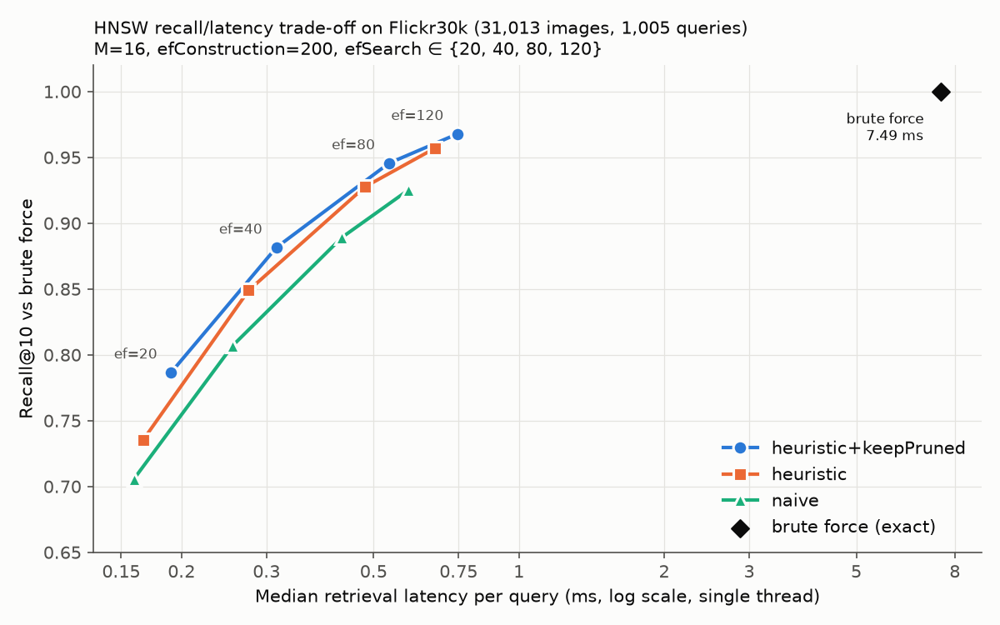

# Semantic Image Retrieval in C++: exact search vs a hand-written HNSW

Type `a dog playing in snow`; get back the most semantically similar images from
Flickr30k. No filenames, tags or captions take part in matching: images and queries are
compared only as CLIP embedding vectors.

**Research question.** How much search latency does a hand-written HNSW index save over
exact brute-force search, and what does it cost in recall?

**Answer (measured, single thread, 31,013 images × 512 dims, 1,005 queries):**

| | Brute force (exact) | HNSW, efSearch = 80 | HNSW, efSearch = 20 |
|---|---|---|---|
| Median latency / query | 7.487 ms | 0.538 ms | 0.191 ms |
| Speedup (median) | 1× | **13.9×** | 39.3× |
| Recall@10 vs exact | 1.000 | **0.946** | 0.787 |
| Distance evaluations / query | 31,013 | 1,384 | 547 |
| Text→image R@1 (held-out captions) | 0.281 | 0.272 | 0.246 |

HNSW: M = 16, efConstruction = 200, heuristic neighbour selection with kept pruned
connections, seed 42. Full sweep, three neighbour-selection variants, memory and build
time: [`evaluation/benchmark_results/summary.md`](evaluation/benchmark_results/summary.md).



**What the contribution is, and is not.** CLIP (OpenAI ViT-B/32 through `open_clip`) is
a pretrained embedding model used as-is. Using it is not a contribution. This project's
contribution is the retrieval engine: the exact baseline, the HNSW graph, and the
controlled exact-vs-approximate analysis. It also includes a graph-connectivity defect
found and fixed along the way (§6.4).

**Quick start** (after the pipeline has been run once, see §9):

```bash
build/sir_cli a dog playing in snow
.venv/bin/python scripts/web_server.py   # then open http://127.0.0.1:8080  (Ctrl+C to stop)
```

---

## 1. Architecture and the Python / C++ boundary

```
                 PYTHON  (data + model inference only)              │              C++20  (everything that is retrieval)
                                                                     │
 HF nlphuji/flickr30k ──► prepare_dataset.py ──► metadata.json ──────┼──► MetadataManager (owns records; ids 0..N-1)
   (zip + captions CSV)   validate / dedupe /     exclusion_report   │            ▲
                          clean captions                             │            │ lookup id → path/score
                                   │                                 │            │
                                   ▼                                 │     ┌──────┴────────────────────────────┐
                        generate_embeddings.py ─► image_embeddings.bin ───►│ EmbeddingStore (owns all vectors) │
                        OpenCV decode, Pillow-      + manifest.json  │     └──────┬───────────────┬────────────┘
                        exact resample, CLIP        (SHA-256, dim,   │            │ const float* rows
                        image encoder (GPU)          normalised)     │   ┌────────┴───────┐ ┌─────┴──────────────┐
                                                                     │   │ BruteForceIndex│ │ HNSWIndex          │
 evaluation/queries.txt ─► encode_queries.py ─► query_embeddings.bin ───►│ (ids + top-K   │ │ (ids + adjacency;  │
                                                                     │   │  heap)         │ │  no vector copies) │
                                                                     │   └────────┬───────┘ └─────┬──────────────┘
                                                                     │            └──RetrievalIndex┘
                                                                     │                    │
 text_encoder_server.py  ◄── length-prefixed frames over socketpair ─┼── TextEncoderProcess (RAII) ──► SearchEngine
 (persistent CLIP text encoder, CPU)                                 │   IndexManager (build/save/load/validate)
                                                                     │   sir_cli · sir_benchmark · sir_build_index
```

**Python owns:** dataset download, image validation, OpenCV preprocessing, CLIP image
inference, embedding + metadata persistence, precomputing query embeddings, and the
CLI's text-encoder helper.

**C++ owns:** reading the JSON files; loading, validating and storing embeddings; vector
math; top-K selection; brute-force search; HNSW (graph, insertion, search, pruning);
ranking; metadata lookup; caption keyword search; index persistence and validation;
benchmarking; the search pipeline; the CLI.

### What is mine vs. what is a library facility

| Component | Implemented here | Library facility used |
|---|---|---|
| Dot product, norm, normalisation, distance convention | ✔ (`src/common.cpp`) | — |
| Growable arrays (`IntArray`, `FloatArray`, `StringArray`, `NeighborArray`, `CandidateArray`: doubling growth, deep copy), `BitArray` | ✔ (`dsa/member4_arrays.cpp`); no STL containers, no templates, no `<algorithm>` anywhere in the C++ code | `new[]` / `delete[]` |
| Binary heap, introsort (quicksort + heap-sort fallback + insertion sort), brute-force index | ✔ (`dsa/member2_sorting.cpp`) | — |
| Caption keyword search: hash table (open addressing, linear probing), inverted index with merge / galloping intersection | ✔ (`dsa/member1_inverted_index.cpp`) | — |
| Bounded top-K selection (O(N log K), total `(dist, id)` order) | ✔ heap and comparators | — |
| Brute-force search | ✔ | — |
| HNSW: level assignment, greedy descent, SEARCH-LAYER with candidate min-heap + result max-heap, bidirectional linking, pruning, naive and heuristic neighbour selection, keepPrunedConnections, last-in-edge protection, visited-epoch markers | ✔ entirely (`dsa/member3_hnsw.cpp`), including the MT19937-64 random generator, checked against the C++ standard's reference value | — |
| Index file format, stale/corruption detection, graph validation (degrees, self-loops, layer consistency, BFS reachability) | ✔ | — |
| SHA-256 (index checksums, embedding-file identity) | ✔ standard FIPS 180-4, tested against NIST vectors | — |
| Search orchestration, query validation, RAII subprocess | ✔ | POSIX `posix_spawn`, `socketpair` |
| Latency statistics, recall metrics, system/memory capture | ✔ | `clock_gettime(CLOCK_MONOTONIC)`, `/proc` |
| JSON parsing (config, metadata, manifests) | ✔ recursive-descent parser (`src/json.cpp`) | — |
| Test runner | ✔ a small `check()` framework (`tests/`) | — |
| Image decoding, colour conversion | — | OpenCV (Python) |
| Bicubic resampling matching CLIP's processor | ✔ NumPy re-implementation of Pillow's fixed-point algorithm | — |
| CLIP model, tokenizer, weights | — | `open_clip_torch`, PyTorch |

No existing ANN library (hnswlib, FAISS, etc.) is used anywhere, and the C++ side links
no third-party library at all. It does not link OpenCV, because all pixel work happens
in Python. From the C++ standard library it uses only `std::string`, streams for file and
console I/O, exceptions and the C maths/string functions.

---

## 2. Data pipeline (Python)

### 2.1 Dataset
Source: Hugging Face `nlphuji/flickr30k`. The files are `flickr30k-images.zip` (4.39 GB)
and `flickr_annotations_30k.csv`. Both are verified against the SHA-256 published in the
repository's LFS metadata (`scripts/download_dataset.sh`). After extraction,
`data/raw/` is made **read-only** (`chmod a-w`), so later steps cannot modify it.

### 2.2 Validation and the bad-data policy
Every candidate is either valid or excluded, exactly once. Candidates are every CSV row
plus every image file with no CSV row. Exclusions go to
`data/processed/exclusion_report.csv` as `image_id, path, reason`. Checks: missing file,
zero bytes, unsupported format (JPEG/PNG/BMP/WEBP/TIFF allowed), a full PIL decode
(which catches truncated or corrupt streams), zero dimensions, and a successful OpenCV
decode whose size agrees with PIL's. Validation never raises; unexpected exceptions
become `unreadable:<type>`. `scripts/test_python_pipeline.py` exercises each path with
synthetic bad files (empty, garbage, truncated JPEG, GIF, missing).

| Result on Flickr30k | Count |
|---|---|
| Total found | 31,783 |
| Valid | **31,013** |
| Excluded: `no_captions` | 769 (images in the zip absent from the HF captions CSV, which covers the 31,014-image Karpathy split) |
| Excluded: `duplicate_of=` | 1 (`3050606344` is byte-identical to `2851198725`) |
| Corrupt / unreadable | 0 |
| found = valid + excluded | 31,783 = 31,013 + 770 ✔ |

### 2.3 Duplicates
- **Duplicate image IDs** in the CSV: keep the first occurrence and exclude the rest
  (`duplicate_of=<id>`). None were found.
- **Duplicate content** (SHA-256 of the file bytes): keep the lowest image ID in sorted
  order and exclude the rest with `duplicate_of=<kept id>`. One was found.

### 2.4 Captions
Captions are normalised to NFC, whitespace is collapsed and ends stripped, and empty
captions are dropped. An image left with zero captions is excluded. Truncation is
flagged per caption, where CLIP BPE tokens + BOS/EOS > 77; 3 of 155,065 captions are
truncated. Captions are metadata only; image embeddings come from pixels.

### 2.5 Preprocessing: why it re-implements Pillow's resampler
The reference CLIP processor resizes with `PIL.Image.resize(BICUBIC)`. That is an
**antialiased** separable bicubic filter (a = −0.5) evaluated in 22-bit fixed point,
with a uint8 round-trip between the horizontal and vertical passes. `cv2.resize(INTER_CUBIC)`
does not antialias when downscaling. Measured on 50 Flickr30k images, it differs from the
reference by a **median max tensor difference of 1.18** (maximum 2.00), with per-pixel
differences up to 136 uint8 levels at edges. That is about 10,000× the 1e-4 gate. So the
pipeline decodes and converts colour
with OpenCV (BGR→RGB), then applies a NumPy re-implementation of Pillow's
`precompute_coeffs` / `normalize_coeffs_8bpc` / `clip8`, with the operation order kept
identical so the integer weights match bit for bit. Then comes the centre crop (offsets
use Python's half-to-even `round`, as torchvision does), /255, and CLIP mean/std.
Every image goes through this one code path.

Odd inputs are converted to 3-channel RGB: grayscale is replicated, palette is expanded,
alpha is composited over white, and CMYK is converted by the decoder. All 31,013 valid
Flickr30k images turned out to be RGB JPEGs, so these paths are exercised only by the
synthetic tests in `scripts/test_python_pipeline.py`. `IMREAD_UNCHANGED`
is used so that EXIF orientation is *not* applied, which matches `PIL.Image.open`.

### 2.6 A silent model-configuration bug caught here
`open_clip` 3.3 builds `ViT-B-32` with standard GELU, but the OpenAI weights were trained
with **QuickGELU**. It prints a warning and continues, and the embeddings are then subtly
wrong. The model is loaded with `force_quick_gelu=True`, which is the same architecture
the weights were trained with, and the manifest records this.

### 2.7 Embeddings, determinism, resumability
- Format: raw little-endian float32, `[N × D]` row-major, no header. Row *i* is
  internal ID *i* (sorted image-ID order). L2 normalisation is computed in float64 and
  stored as float32.
- The manifest records model, dim, rows, normalised flag, dtype, UTC timestamp, git
  commit and SHA-256 (plus library versions, device, seed and a preprocessing
  description).
- Determinism: fixed seeds, `torch.use_deterministic_algorithms(True)`, TF32 off,
  deterministic cuBLAS workspace.
- Resumability: rows are appended to `.partial`. Every 10 batches the data is
  `fsync`'ed and then a checkpoint is atomically replaced. On restart the file is
  truncated to the checkpoint and generation continues. Batches align to multiples of
  the batch size from row 0, so a resumed run computes exactly the same batches.
  **Verified:** the job was SIGKILLed at 6,400 checkpointed rows (512 rows past the
  checkpoint were discarded), then resumed. The result was **byte-identical** to a
  separate uninterrupted run (SHA-256 `53cc14e4…2c0a25` for both).

---

## 3. C++ engine

### 3.1 Ownership model
| Object | Owns | Referenced by |
|---|---|---|
| `MetadataManager` | all `ImageRecord`s | `SearchEngine` |
| `EmbeddingStore` | one contiguous `float` block [N × D] from `new[]` | both indexes, `SearchEngine` (via row pointers) |
| `BruteForceIndex` | an `IntArray` of ids | `SearchEngine` through `RetrievalIndex&` |
| `HNSWIndex` | node levels, adjacency lists, in-degrees, visited markers | `SearchEngine` through `RetrievalIndex&` |
| `SearchEngine` | nothing (non-owning pointers) | the apps |
| `TextEncoderProcess` | child PID + socket (RAII: closes, waits, escalates to SIGTERM/SIGKILL) | the CLI |

Vectors are stored exactly once. Indexes hold ids only and read rows through
`EmbeddingStore::row(i)`, which returns a pointer to the row. `insert(id, row)` checks
that the row holds exactly the store's values, so no index can be fed a different vector.
Memory comes from `new[]` inside classes whose destructors free it. The array classes have
copy constructors and copy assignment that copy the whole block (deep copy); classes
that own large data (`EmbeddingStore`, `HNSWIndex`, `MetadataManager`) cannot be copied.

### 3.2 One distance convention
`dist(a, b) = 1 − dot(a, b)` on unit vectors, where lower is better. Every priority
queue, comparator and pruning decision uses it, with a total order `(dist, id)`, so
exact ties break by ascending id. Flickr30k has near-duplicate images, so ties do occur.
Similarity (`score = 1 − dist`) exists only at the `RetrievalIndex` output boundary.
Because that float conversion can map two distinct distances to one score, the output is
re-sorted by `(score desc, id asc)`.

`dot` is defined **out of line on purpose.** When it was an inline header function, the
compiler generated different code per call site, and a test caught 1-ulp score
differences between two call sites computing the same pair. With one compiled instance,
every distance in the system is bit-identical for the same pair of vectors. Exact tie
ordering and the "HNSW == brute force at high ef" gate both depend on that.

### 3.3 Brute force
It scores every vector and keeps the best K in a bounded max-heap whose top is the worst
retained item: O(N log K), not a full sort. It is single-threaded, with no BLAS, no
OpenMP and no intrinsics.

*What the compiler actually emits* (checked with `objdump`): with the pinned
`-O3 -march=native`, GCC vectorises the **multiplications** of `dot` (`vmulps` on 8
lanes), but keeps the **summation** as a serial chain of scalar `vaddss` in source
order. That is required by IEEE semantics without `-ffast-math`. Results are identical
to a pure scalar loop, and the serial add chain is the bottleneck. Both backends call
this same compiled function, so the speedup reflects the algorithms, not tuning effort.

### 3.4 HNSW (from scratch)
- **Levels:** `floor(−ln U · mL)` with `mL = 1/ln M`. U ∈ (0, 1] is built from the top 53
  bits of a seeded MT19937-64 (written by hand; same sequence as `std::mt19937_64`).
  A library uniform distribution is avoided because its output is implementation-defined. Measured distribution: L0 = 31,013, L1 = 1,924,
  L2 = 121, L3 = 11, L4 = 3, L5 = 1 (expected ≈ N/16ᵏ).
- **Insert:** greedy descent through the layers above the node's level. On each layer
  ≤ its level: SEARCH-LAYER with `efConstruction`, then SELECT-NEIGHBORS(M), then
  bidirectional links, then prune any neighbour list over Mmax (M, or 2M on layer 0).
- **Search:** greedy descent to layer 1, then SEARCH-LAYER on layer 0 with
  `ef = max(efSearch, k)`. SEARCH-LAYER keeps a **candidate min-heap** (closest on top,
  the next node to expand) and a **result max-heap** (farthest on top, the current worst
  of the best ef). It stops when the closest candidate is worse than the worst result.
  Visited nodes are tracked with an epoch-stamped array (O(1) reset per query).
- **Neighbour selection** (`--select-heuristic heuristic|naive`):
  - *naive*: the M closest candidates.
  - *heuristic* (paper Alg. 4, `extendCandidates` off): take candidates closest-first
    and keep one only if it is closer to the base node than to every already-kept
    neighbour. Optionally (`keep_pruned_connections`, the paper's option) top the list
    back up to M with the closest discarded candidates.
- **Last-in-edge protection (my addition, not in the paper):** see §6.4.
- **Not thread-safe:** `search` reuses a mutable visited array. The benchmark is
  single-threaded by protocol, and multi-threaded search is out of scope.

### 3.5 Index lifecycle and persistence
`IndexManager::build / save / load / validate / rebuild`. The file layout (version 2) is
documented in `include/storage.h`. It contains a magic number `SIRHNSW\0`,
format version, model name, dim, store row count, vector count, M / efConstruction /
efSearch / seed / selection flags, the SHA-256 of the source embedding file, entry point,
max level, RNG state (312 raw words; version 1 stored the library's text form),
adjacency payload, and a trailing SHA-256 over every preceding
byte. Saves write a temp file and rename it, so a half-written index never replaces a
good one.

`load` rejects each of these with a specific message:
- wrong magic or version
- truncation or trailing data
- a checksum mismatch (corruption)
- a different model, dim, row count or embedding file (stale index)
- out-of-range levels, degrees or links

After loading it re-runs graph validation.

### 3.6 SearchEngine and query-time text embedding
`SearchEngine` validates K first, before any expensive work. It then normalises the
query text (trim, collapse whitespace), gets a raw vector from a `QueryEncoder`,
validates it (dim, NaN/Inf, zero norm) and L2-normalises it. It calls
`RetrievalIndex::search`, timing only that call, and maps ids to metadata. It never sees
HNSW internals, and the results (`CandidateArray`) are the same type for both backends.

**Why the tokenizer is not in C++.** CLIP's tokenizer is a 49k-entry byte-level BPE
vocabulary plus merge rules and ftfy/HTML cleaning. A subtly wrong port produces
plausible-looking but wrong rankings. That is a large correctness risk, and it buys
nothing for the research question, because the retrieval engine is what is being
measured. So:
- **Benchmarks** read `evaluation/query_embeddings.bin`, precomputed by
  `scripts/encode_queries.py` in the same format and manifest schema as the image
  embeddings. The benchmark path is pure C++ and reproducible.
- **The CLI** spawns `scripts/text_encoder_server.py` once and talks to it through
  4-byte little-endian length-prefixed frames over a `socketpair`. A socket (rather than
  pipes) lets the C++ side use `MSG_NOSIGNAL`, so a dead helper produces an error
  message instead of a SIGPIPE crash. The helper's stdout carries protocol frames only;
  its logs go to stderr.

### 3.7 Errors (all with specific messages)
Each of these is tested:
- empty or whitespace-only query
- K ≤ 0
- K > N
- missing index file
- corrupted or truncated index
- stale index
- dimension mismatch (embeddings vs config, and query vs index)
- NaN or Inf in a query vector
- zero-norm query
- invalid embedding rows (the error names the row)
- text-encoder startup failure

---

## 4. Verification gates (all run; numbers from `evaluation/results/`)

| Gate | Result |
|---|---|
| **G1** Dataset | 31,783 found / 31,013 valid / 770 excluded (sum ✔); 155,065 captions; 0 unreadable/corrupt. I opened 5 random images and all match their captions (cricketer, man at computer, girl at telescope, comedian, boy + dog). |
| **G2** Preprocessing fidelity | 10/10 images: max abs tensor diff **0.0** (gate < 1e-4), embedding cosine **1.0000000** (gate ≥ 0.9999). Extended check on 2,000 images: all 0.0. |
| **G3** Embeddings | 31,013 rows = valid count; dim 512; 0 NaN, 0 Inf, 0 zero-norm; norms min 0.99999998, max 1.00000002, mean 1.00000000; 5 re-embedded rows cosine 1.0000000; resume byte-identical to uninterrupted run. |
| **G4** Semantic sanity | All 25 result images opened. Dogs in snow 5/5; two guitarists on stage 5/5 on-topic; child on bike 5/5, but a red *bike* only in 1/5 (red helmets elsewhere, a known CLIP attribute-binding weakness); outdoor restaurant 3/5 clearly relevant; surfer 4/5 (one white-water kayak). |
| **G5** C++ loader | 5 rows: max abs diff **0.0**, bit-identical; first 4 values identical on both sides. |
| **G6** Math + top-K | Hand-computed dot/norm/normalise pass; normalisation idempotent; top-K vs full sort **100/100** trials exact including injected ties. |
| **G7** Brute force vs NumPy | 50 queries, K = 10: **0** id mismatches; max score deviation **4.5e-7** (gate 1e-5). |
| **G8** HNSW synthetic | N = 10 and N = 100 (D = 8), efSearch = N: identical to brute force for all 50 random + N self-queries, both selection methods. N = 5,000, D = 32, Recall@10 at ef 20/40/80/120: heuristic+keepPruned 0.830 / 0.947 / 0.996 / 0.999; naive 0.819 / 0.939 / 0.994 / 1.000 (Gaussian test vectors from the project's own generator). |
| **G9** HNSW on Flickr30k | Recall@10 at efSearch = 80: **0.9456** (gate ≥ 0.90). Layer-0 graph fully connected: 31,013/31,013 reachable. |
| **G10** Persistence | Build → save → load in a fresh process → 50 queries: **500/500 results identical** (ids and score bits). One flipped byte (offset 1,781,378: 0x15 → 0xea): rejected, "index file is corrupted (SHA-256 checksum mismatch)". Truncated and missing files are also rejected. |
| **G11** End to end | `sir_cli a dog playing in snow` returns 5 existing paths, identical for both backends, which are the same 5 dog-in-snow images viewed at G4. |
| **G12** Caption inverted index | 31,013 images, 15,716 words, 607,917 postings (caption 0, the held-out query caption, excluded). 200 random 1–3 word AND and OR queries: **0** mismatches against a linear scan, about 58× faster. Hash table at load factor 0.48: mean probe length 1.455 (linear-probing theory: 1.46). |

Plus: `sir_tests` (run by `ctest`), 154 checks in 16 groups covering the arrays, random generator, JSON, store, metadata, hash table, inverted index, math, sorting, top-K, brute force, search engine, HNSW, SHA-256, persistence and the real text encoder; and the Python robustness tests (13 checks).

**Simplification rewrite.** The C++ code was rewritten for a third-semester level: no
templates, lambdas, `std::span`, move semantics or third-party libraries, and 5 headers
instead of 29. Before the rewrite, reference outputs were recorded on the full dataset,
and the rewritten engine reproduces them **bit for bit**: raw embedding rows (G5 data),
brute-force top-10 for 1,000 queries, HNSW top-10 for 1,000 queries (ids and exact score
bits, so the graph is identical), every G9 recall and distance count, and the G12 caption
statistics. The G8 synthetic numbers changed only because the test vectors now come from
the project's own Gaussian generator.

---

## 5. Benchmark

The numbers in this section come from the pinned benchmark run made before the
simplification rewrite. The rewrite returns bit-identical search results (§4), so every
recall, distance-count and quality number still holds. Latency and memory depend on the
code, so re-run `sir_benchmark` (§9) to refresh them.

### 5.1 Protocol
- Release build with exactly `-O3 -march=native -DNDEBUG`, single thread.
- The process is pinned with `sched_setaffinity` to one performance core (CPU 4). The
  i7-13620H is a hybrid CPU with 4.7–4.9 GHz P-cores and 3.6 GHz E-cores, and letting
  the scheduler migrate a run between core types would make latencies meaningless. The
  text-encoder helper is spawned *before* pinning so it does not inherit the affinity.
- 1,005 queries: the 5 hand-written G4 queries plus 1,000 held-out captions. All are
  read from the same precomputed `query_embeddings.bin` for every backend.
- 20 warm-up queries are discarded. Then come 5 timed repetitions over all queries,
  repetition-outer, so the same query never runs twice in a row with a hot cache.
- Per-query latency is the median of its 5 repetitions. The headline is the median
  across queries, with p95 and mean also reported. Timing uses
  `std::chrono::steady_clock` around `search()` only.
- Environment (from `system.json`):
  - CPU: i7-13620H, 16 logical / 10 physical cores
  - RAM: 15.3 GiB
  - OS: Fedora 44, kernel 7.2.5
  - Compiler: GCC 16.2.1
  - CPU governor: `powersave` (intel_pstate)
  - On AC power
  - Load average at start: 0.39
  - Git commit: `9c14e0e`
  - HNSW seed: 42

### 5.2 Results (M = 16, efConstruction = 200)

| Selection | efSearch | Median ms | p95 ms | Speedup | Recall@5 | Recall@10 | Dist evals/q | Build s |
|---|---|---|---|---|---|---|---|---|
| brute force | – | 7.4875 | 7.5737 | 1.0× | 1 | 1 | 31,013 | – |
| heuristic + keepPruned (default) | 20 | 0.1905 | 0.2586 | 39.3× | 0.8094 | 0.7867 | 547 | 37.2 |
| | 40 | 0.3144 | 0.4038 | 23.8× | 0.8973 | 0.8815 | 847 | |
| | 80 | 0.5381 | 0.6638 | 13.9× | 0.9562 | 0.9456 | 1,384 | |
| | 120 | 0.7465 | 0.9160 | 10.0× | 0.9765 | 0.9679 | 1,879 | |
| heuristic | 80 | 0.4796 | 0.5830 | 15.6× | 0.9419 | 0.9276 | 1,216 | 24.9 |
| naive | 80 | 0.4302 | 0.5628 | 17.4× | 0.9029 | 0.8893 | 1,103 | 19.9 |

Full sweep for every variant, mean latencies and fraction of perfect-recall queries:
[`latency_recall.csv`](evaluation/benchmark_results/latency_recall.csv) and
[`summary.md`](evaluation/benchmark_results/summary.md).

### 5.3 Naive vs heuristic neighbour selection (efSearch = 80)
The heuristic raises Recall@10 from **0.889 to 0.928**, and to **0.946** with kept pruned
connections. At the same efSearch it costs more per query, because it evaluates more
distances. Compared at *equal latency* (see the plot), both heuristic variants beat
naive everywhere. For example, heuristic+keepPruned reaches 0.88 recall at 0.31 ms,
while naive reaches 0.889 only at 0.43 ms. keepPruned beats the plain heuristic below
about 0.45 ms, and the two curves converge above that. The heuristic keeps neighbours that point in
different directions, which preserves the long-range links between clusters that a
greedy walk needs. Naive selection spends its M links on a node's own tight cluster.

### 5.4 Why the speedup (13.9×) is smaller than the work reduction (22.4×)
At efSearch = 80, HNSW evaluates 22.4× fewer distances than brute force, but runs only
13.9× faster. Per distance evaluation, brute force costs about 241 ns
(7.487 ms / 31,013), while HNSW costs about 389 ns (0.538 ms / 1,384). HNSW pays for
random-access row reads (cache misses instead of a sequential stream), two heap
operations per accepted neighbour, and visited-marker checks. Brute force streams the
matrix linearly, which the hardware prefetcher handles well.

### 5.5 Why real-data recall is lower than synthetic recall at the same efSearch
On 5,000 synthetic vectors, HNSW reaches Recall@10 ≈ 0.996 at ef = 80. On Flickr30k it
reaches 0.946. A measured contributing factor is the **text-image modality gap**. A
text query's best image has median cosine similarity **0.346**, while an image's
nearest other image has median cosine **0.825** (`scripts/diag_modality_gap.py`). The
queries lie far from the data they are searched against, so the graph was built for
neighbourhoods the queries do not sit in, and the greedy walk has less signal to follow.
The gap is measured here; the causal link to recall is a hypothesis this project did not
isolate.

### 5.6 Memory (two ways, because they differ)
| Measure | Bytes | MiB |
|---|---|---|
| `EmbeddingStore::memoryBytes()` (shared by both backends) | 63,514,624 | 60.57 |
| `BruteForceIndex::memoryBytes()` (id list) | 127,932 | 0.12 |
| `HNSWIndex::memoryBytes()` (graph only) | 7,024,500 | 6.70 |
| Peak RSS (VmHWM) after loading embeddings + queries | 70,295,552 | 67.04 |
| Peak RSS at end of benchmark | 79,605,760 | 75.92 |

So the HNSW graph adds about 11% on top of the vectors it indexes. After the rewrite the
same graph reports `memoryBytes()` = 5,767,500 (5.50 MiB, about 9%), because the new array
classes carry less bookkeeping per node.

`memoryBytes()` counts **reserved** capacity: 2M+1 ints per node on layer 0 and M+1 on
upper layers, reserved at insertion to avoid reallocation. That is why it is identical
for all three variants. The saved index files reflect the edges actually in use:
3,479 KiB for heuristic+keepPruned (mean layer-0 degree 25.5), 2,609 KiB for the
heuristic (18.6) and 3,314 KiB for naive (24.2). VmHWM also counts the C++ runtime, the
query file, the ground-truth result lists and allocator slack.

### 5.7 Query embedding time (reported separately, excluded from retrieval latency)
The Python CLIP text encoder on CPU, including IPC, takes a median of **21.5 ms** and a
p95 of 24.1 ms over 100 queries. That is roughly 40× the HNSW retrieval time. For an
interactive user, end-to-end latency is dominated by the text encoder, not the index.
At 31k images, even brute force (7.5 ms) is well under the encoder cost. The HNSW
advantage matters as the collection grows, because brute force scales linearly with N.

---

## 5b. Local web page (optional demo layer)

`.venv/bin/python scripts/web_server.py` serves a page at **http://127.0.0.1:8080** with a
search box, K (5/10/20), an efSearch slider and example queries. It shows brute-force and
HNSW results side by side as thumbnails with scores, the first caption for reference,
both latencies, speedup and Recall@K, and flags images that one index found and the other
did not. A low efSearch makes recall loss visible.

- **All search work is C++.** The Python script (standard library only) serves the page
  and image files, and starts the engine once as `build/sir_cli --serve`. It sends each
  search as one line `k<TAB>ef<TAB>query` on the engine's stdin and gets one JSON line
  back. The engine runs the same `compareBackends` routine as the CLI.
- Binds to `127.0.0.1` by default. Images are served only by numeric internal id
  (`/img/<id>`), so no path from the browser reaches the filesystem. Searches are
  serialised with a lock, because the engine handles one request at a time.
- K ≤ 50 and 1 ≤ efSearch ≤ 1000; bad input gets HTTP 400 with the engine's message.
- Ctrl+C closes the engine's input; it exits and stops the text-encoder helper.
- Latencies on the page are unpinned single-query medians, for illustration only.
- Options: `--port`, `--host`, `--index`, `--encoder-log`.

---

## 6. Absolute retrieval quality, and a defect found on the way

### 6.1 Held-out caption track (§9 of the brief)
Caption #1 of 1,000 randomly sampled images (seed 2024) is used as the query, and its
own image is the only correct answer. The search runs over the **full 31,013-image
gallery**.

| Backend | R@1 | R@5 | R@10 |
|---|---|---|---|
| brute force (quality ceiling) | 0.281 | 0.517 | 0.598 |
| HNSW default, efSearch = 20 | 0.246 | 0.441 | 0.502 |
| HNSW default, efSearch = 80 | 0.272 | 0.497 | 0.576 |
| HNSW default, efSearch = 120 | 0.276 | 0.507 | 0.591 |

At efSearch = 80, HNSW keeps 97% of the exact R@1 (0.272 / 0.281).

### 6.2 Comparability check against a published reference
These numbers are **not** comparable to published zero-shot results, which use the
Karpathy 1K-test protocol: 1,000 images and all 5,000 of their captions. A 31× larger
gallery makes the task much harder. So `scripts/eval_standard_1k.py` also evaluates that
standard protocol, with exact search over our own embeddings:

| Text→image, Flickr30k 1K test | R@1 | R@5 | R@10 |
|---|---|---|---|
| **Measured here** | 0.5876 | 0.8350 | 0.9004 |
| Reference: open_clip's published table, row `ViT-B-32, openai`, column "Flickr image retr." ([`docs/openclip_retrieval_results.csv`](https://github.com/mlfoundations/open_clip/blob/main/docs/openclip_retrieval_results.csv)), not measured by this project | 0.5878 | 0.8356 | 0.9002 |

The two agree within 0.0006 on every metric. This is independent evidence that the
download, preprocessing, QuickGELU fix and embedding pipeline are all correct.

### 6.3 Relationship between the two tracks
Recall-against-brute-force measures whether HNSW is **faithful** to exact search. The
held-out track measures whether the system is **useful**. They diverge: at efSearch = 80,
HNSW misses 5.4% of the exact top-10, but loses only 0.9 points of R@1. Many of the
missed neighbours are near-ties that are not the correct image anyway.

### 6.4 Defect found and fixed: pruning disconnected the graph
The first build passed G9 (Recall@10 = 0.927), but graph validation showed that **4 of
31,013 nodes were unreachable** on layer 0. No query could ever return those images.
All four were outliers: their nearest-neighbour similarity was only 0.58–0.75, and they
had 1–2 out-links.

The mechanism:
1. When an outlier is inserted, its candidates all lie in one tight cluster. The
   heuristic keeps the closest candidate and rejects the rest as "covered".
2. So the outlier gets one out-link, and therefore one in-link.
3. When that neighbour's list later overflows, the heuristic prunes the outlier first.
   Now nothing points to it.

Fixes, measured (Recall@10 at efSearch = 80; `evaluation/results/g9_ablation.txt`):

| Variant | Unreachable nodes | Recall@10 | Dist evals/q |
|---|---|---|---|
| heuristic | 4 | 0.9273 | 1,216 |
| heuristic + keepPruned (paper option) | 1 | 0.9455 | 1,384 |
| heuristic + last-in-edge protection | **0** | 0.9276 | 1,216 |
| heuristic + keepPruned + protection (**default**) | **0** | 0.9456 | 1,384 |
| naive | 11 | 0.8888 | 1,103 |
| naive + protection | **0** | 0.8893 | 1,103 |

`keepPrunedConnections` alone left the most extreme outlier (id 728) orphaned, even with
16 out-links, because all 16 of its neighbours pruned it. **Last-in-edge protection**
(my addition) tracks per-layer in-degree incrementally. When pruning would remove a
node's *only* incoming edge, it keeps that edge instead and drops the farthest kept edge
whose target has another in-edge. It reaches full connectivity for every variant at
negligible recall and latency cost. A unit test checks that the incremental in-degree
bookkeeping always equals a full recount.

---

## 7. Decisions log

| Decision | Choice and reason |
|---|---|
| Python version | 3.11 venv. Chosen up front because torch/open_clip wheel support for the system's 3.14 was uncertain; 3.14 was not tested. |
| Model loading | `force_quick_gelu=True`: required for OpenAI weights under open_clip 3.x (§2.6). |
| Resampling | Pillow-exact NumPy re-implementation, because OpenCV's cubic cannot meet G2 (§2.5). |
| EXIF orientation | Not applied, matching the reference processor. |
| Internal id order | Sorted image-ID, as a lexicographic string sort (deterministic, documented in metadata). |
| Duplicate policy | Keep the first by sorted ID, exclude the others as `duplicate_of=<id>`. |
| Images without captions | Excluded (`no_captions`), as the brief's rule requires; 769 images. |
| "Caption #1" | `captions[0]` after cleaning. |
| Query set | 5 hand-written + 1,000 held-out captions = 1,005 (brief: ≥ 200). The same set drives both the latency/recall and the quality tracks. |
| Latency statistic | Per-query median of 5 reps, then median/p95/mean across queries; repetition-outer ordering. |
| p95 | Nearest-rank method. |
| CPU pinning | In-process `sched_setaffinity` to a P-core; the encoder helper is spawned before pinning. |
| Default HNSW selection | Heuristic + keepPrunedConnections + last-in-edge protection: best recall per latency and full connectivity (§6.4). Naive and plain heuristic are kept behind flags and benchmarked. |
| `extendCandidates` (paper option) | Off, as in common practice. Not evaluated. |
| Upper-layer routing | Greedy closest-neighbour walk, equivalent to SEARCH-LAYER with ef = 1. |
| Search ef | `max(efSearch, k)`. |
| Level RNG | MT19937-64 written by hand (same sequence as `std::mt19937_64`); bits mapped to (0, 1] by hand, for portability across standard libraries. |
| `dot` placement | Out of line, one compiled instance (§3.2). |
| Text encoder device | CPU in the helper (portable, no GPU contention); GPU for bulk image and query precompute. |
| IPC | `socketpair` + `posix_spawn` rather than pipes, to avoid SIGPIPE (§3.6). |
| JSON metadata | A single JSON file (20.5 MB), read by the project's own recursive-descent parser into a first-child / next-sibling tree. |
| C++ OpenCV | Not linked: C++ never touches pixels. |
| Index checksum | SHA-256 over the whole file, so corruption anywhere is detected, not just in the header. |
| Code level | Rewritten for a third-semester course: classes, pointers, `new[]`/`delete[]`, operator overloading, virtual functions and exceptions; no templates, lambdas, `std::span`, move semantics or third-party libraries. 5 headers (`include/`), each member's DSA file in `dsa/`. Results verified bit-identical to the earlier version (§4). |
| Web page | The original C++ web server needed the cpp-httplib library, so after the rewrite the page is served by a standard-library Python script that forwards searches to `sir_cli --serve` (§5b). Added at the author's request; the brief listed a web UI as out of scope. |

---

## 8. Known limitations (honest list)

1. **Benchmark noise.** The run was on a laptop with a desktop session open (IDE and a
   chat app; load average 0.39), under the `powersave` governor with `intel_pstate`. P95
   and mean are close to the median (brute force 7.49 / 7.57 / 7.50 ms), which suggests
   noise is modest, but a quiet dedicated machine would be better. The numbers are from
   one run; I did not repeat the whole benchmark to estimate run-to-run variance.
2. **Near-tie fragility vs float64 NumPy.** In G7 the smallest adjacent-score gap was
   1.1e-6, only about 2.5× the float32 summation error (4.5e-7). On much larger query
   sets, occasional rank swaps against a float64 reference are possible. Swaps between
   the two C++ backends are not possible, because they share one `dot`.
3. **Auto-vectorised multiplies.** "Scalar" means scalar source. The compiler vectorises
   the products but not the reduction (§3.3). Both backends share this kernel, so the
   comparison is fair, but absolute latencies depend on it.
4. **One build seed, one parameter point.** Recall is reported for seed 42 and M = 16,
   efConstruction = 200 only. Graph-construction variance across seeds was not measured.
5. **No incremental deletes or updates.** The index is built once from the full store.
6. **The modality-gap explanation (§5.5) is a hypothesis.** The gap is measured, but its
   effect on recall was not isolated with an in-distribution query set.
7. **CMYK conversion** differs slightly from PIL's (mean 0.98 uint8 levels in the
   synthetic test). Every Flickr30k image is RGB JPEG (checked for all 31,013), so no
   embedding is affected, and the odd-mode paths are tested only synthetically.
8. **Query text normalisation in C++** is whitespace-only. Unicode normalisation happens
   in the Python tokenizer (ftfy). The C++ side does not NFC-normalise the query.
9. **The CLI's single-query latencies are illustrative.** The CLI is unpinned, and one
   query is not a benchmark. Use `sir_benchmark` numbers.
10. **Dataset coverage.** 769 Flickr30k images have no captions in the HF source, so they
    are excluded rather than indexed without captions.
11. **Repeated array code.** Without templates, each growable array (`IntArray`,
    `FloatArray`, ...) repeats the same code for its element type, and `sortNeighbors`
    sorts only `Neighbor` items.

---

## 9. Reproduce from a clean checkout

Requirements:
- Linux x86-64, GCC ≥ 13 (C++20), CMake ≥ 3.20, Python 3.11
- about 10 GB of free disk
- network access (Hugging Face, for the dataset and model weights)
- an NVIDIA GPU is optional (it speeds up the embedding step)

Everything in one go, where each step is a gate and the script stops on the first
failure:

```bash
PIN_CPU=4 scripts/run_all.sh   # choose a performance core from `lscpu -e`
```

Or step by step:

```bash
python3.11 -m venv .venv
.venv/bin/pip install -r requirements.txt --extra-index-url https://download.pytorch.org/whl/cu124
scripts/download_dataset.sh                       # SHA-256 verified
.venv/bin/python scripts/prepare_dataset.py       # -> metadata.json, exclusion_report.csv
.venv/bin/python scripts/test_python_pipeline.py
.venv/bin/python scripts/gate_g1_dataset.py
.venv/bin/python scripts/gate_g2_preprocess.py
.venv/bin/python scripts/generate_embeddings.py   # resumable; rerun after a crash
.venv/bin/python scripts/gate_g3_embeddings.py
.venv/bin/python scripts/gate_g4_semantic.py
.venv/bin/python scripts/make_queries.py && .venv/bin/python scripts/encode_queries.py

cmake -S . -B build -DCMAKE_BUILD_TYPE=Release && cmake --build build -j
ctest --test-dir build --output-on-failure
.venv/bin/python scripts/gate_g5_loader.py
.venv/bin/python scripts/gate_g7_bruteforce.py
build/sir_build_index                              # G9; writes data/index/hnsw.idx
build/sir_benchmark --pin-cpu 4 --measure-encoder  # -> evaluation/benchmark_results/
.venv/bin/python scripts/plot_benchmark.py
.venv/bin/python scripts/eval_standard_1k.py

build/sir_cli a dog playing in snow                # one query
build/sir_cli --k 10 --ef 120                      # interactive; empty line exits
build/sir_gate caption-index                       # G12: caption keyword search
.venv/bin/python scripts/web_server.py             # web page at http://127.0.0.1:8080
```

Useful flags:
- `sir_build_index`: `--select-heuristic heuristic|naive`, `--keep-pruned 0|1`,
  `--protect-in-edge 0|1`, `--M`, `--ef-construction`, `--out`
- `sir_cli`: `--k`, `--ef`, `--index`, `--encoder-log`, `--serve` (engine for the web page)

---

## 10. Layout

```
config/config.json          every tunable (model, dim, paths, HNSW, evaluation, seeds)
include/                    5 headers, declarations only
  common.h                  errors, arrays, vector math, timer, MT19937-64, path helpers
  data.h                    Member 1: JSON, config, metadata, EmbeddingStore, hash table, inverted index
  search.h                  Member 2: sort, heap, top-K, RetrievalIndex, BruteForceIndex, SearchEngine
  hnsw.h                    Member 3: HNSWIndex, latency/recall, system info
  storage.h                 Member 4: SHA-256, IndexManager (file format), TextEncoderProcess, CLI helpers
dsa/                        each member's DSA-heavy file (compiled into the engine)
  member1_inverted_index.cpp  member2_sorting.cpp  member3_hnsw.cpp  member4_arrays.cpp
src/                        the rest of the engine: common, json, data, search, benchmark,
                            sha256, index_manager, text_encoder, app
apps/                       sir_cli, sir_benchmark, sir_build_index, sir_gate
web/                        index.html (the web page; served by scripts/web_server.py)
tests/                      sir_tests: test_main.cpp + one file per member (154 checks)
scripts/                    Python pipeline, gate scripts, helper server, plots, run_all.sh
data/raw/                   read-only after download (git-ignored)
data/processed/, data/embeddings/   derived data (large files git-ignored; manifests/reports committed)
evaluation/results/         per-gate outputs;  evaluation/benchmark_results/  CSV, JSON, markdown, plot
```

**Architectural inspiration only:**
[comptech-winter-school/image-finder](https://github.com/comptech-winter-school/image-finder),
for the idea of separating embedding generation, exact retrieval, HNSW retrieval and
search orchestration. No code was taken from it.

**Reference:** Y. A. Malkov and D. A. Yashunin, "Efficient and robust approximate nearest
neighbor search using Hierarchical Navigable Small World graphs," *IEEE TPAMI* 42(4),
2020 (arXiv:1603.09320).
